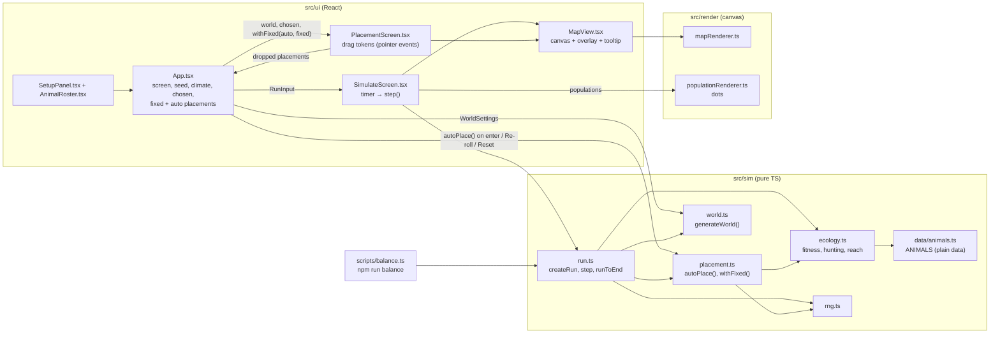

# How Thousand Years Later works

This file explains the project end to end. Keep it current: update it at the end of every build step.

_Last updated: 2026-10-19, step 2 (animals, food chain, populations, placement and simulate screens), after the step 2 playtest fixes (extinctions, biomass ranking, shore habitat, presets, placement)._

## Player flow

| Stage | What happens | Status |
| --- | --- | --- |
| **Setup: world** | Pick a climate preset, tweak sliders (temperature, rainfall, sea level, chaos), set or randomize a seed. The hex map updates live. | ✅ Built |
| **Setup: animals** | Pick 3 to 5 from the roster of 13 animals + 3 human versions (cards, amber border when selected). "Choose starting spots" → Placement. "Or start now with auto placement" → Simulate. | ✅ Built |
| **Place** (optional) | Every animal starts auto-placed (seeded). Drag tokens (mouse or touch) to place them yourself, anywhere the animal can live (land animals not at sea, sea animals not on land, shore animals by the water). While dragging: target biome and fit, or "Can't survive here" in red. Placing one animal never moves the auto ones. Sidebar: region, fit, Auto/Placed. Re-roll auto / Reset / Start 1,000 years. | ✅ Built |
| **Simulate** | 100 ticks of 10 years: plants regrow, feeding (plants, predation), growth with shared room, migration, extinction. Year counter, play/pause, 1×/4×/16×, skip to end, species ranked by biomass (bars) with head count, regions and status, raw event list. | ✅ Built (no mutations, species, events yet) |
| **Run finished** | Placeholder panel at year 1000: top animal (biomass, regions), survivors, extinctions, "Run again" (back to Placement, same setup) and "New setup". | ✅ Placeholder |
| **Reveal** | "A thousand years later…": before/after maps, discovery cards, headlines, new species, family tree, extinctions, postcard. | ⏳ Planned (step 4) |

## Code flow (what exists today)

### 1. Settings become a world

- `WorldSettings` (`src/sim/world.ts`): `seed` (string) plus `temperature`, `rainfall`, `seaLevel`, `chaos`, all 0–1.
- Presets (`src/sim/presets.ts`) are named sets of those four numbers plus a `mainBiome` (the biome the preset is known for; a test checks it is common). `PRESETS` is the list shown as chips. Archipelago: sea level 0.5, so half land, broken into islands (3–4 on most seeds). Jungle: hot (0.95), wet (0.8), sea 0.3, about half its land is jungle. Mixed: 0.62 / 0.38, mostly forest and grassland with some desert, coast and tundra.
- `generateWorld(settings)` in `src/sim/world.ts` is a pure function that returns a `World`:
  1. **Grid.** 8 columns × 6 rows = 48 pointy-top hexes. Stored in axial coordinates (`q`, `r`), laid out as a rectangle in "odd-r" offset form (odd rows shift right). Region `id = row * cols + col`. Hex math is in `src/sim/hex.ts` (`offsetToAxial`, `gridNeighbors`, `hexToPixel`, `pixelToHex`, `hexCorners`).
  2. **Random fields.** Each field gets its own RNG stream: `createRng(seed + "|elevation")`, `"|moisture"`, `"|jitter"`, `"|volcano"`. `smoothField` blurs random values across hex neighbors (2 passes) and stretches them back to 0–1, so land forms blobs instead of speckles.
  3. **Elevation.** Smoothed noise, lowered toward the map edges (so land gathers in the middle), plus chaos-driven roughness, then normalized to 0–1. Above sea level 0.42 the land breaks up: by 0.5 the edge pull is 80% weaker and roughness is +0.8, so high seas give several islands instead of one continent.
  4. **Water.** Rank-based: the lowest `round(seaLevel × 48)` regions (ties by id) are water, so sea level is exactly the share of the map under water on every seed. `landHeight` is measured from the highest flooded region.
  5. **Moisture.** Water is 1. Land is rainfall + noise + a bonus for each water neighbor.
  6. **Temperature.** Global temperature, minus latitude (cooler toward the top and bottom rows), minus height above sea level.
  7. **Biome.** `classifyBiome` in `src/sim/biomes.ts` picks from temperature, moisture, height and whether the region touches water. Very cold water becomes `ice` but keeps `isWater: true`. `volcanic` only appears when chaos > 0.7 (chance `(chaos − 0.7) × 3.5` on high land; the Volcanic preset uses 0.9). Hot land (> 0.6) is jungle above moisture 0.5; in the tropics (> 0.7) swamp needs moisture > 0.95 instead of 0.8, so rainforest isn't drowned by swamp.
  8. **Plant food.** `BASE_PLANT_FOOD[biome]`, nudged up by moisture on land.
- Helpers: `regionNeighbors(world, id)` and `regionIdAt(world, q, r)`.

### 2. The world gets drawn

- `src/render/mapRenderer.ts`:
  - `computeLayout(world, width, height)` fits the whole grid into the canvas and returns `{ size, originX, originY }`.
  - `drawMap(ctx, world, layout, hoveredId, outlineColor)` fills each hex with its biome color (`src/render/colors.ts`), leaving a small gap, and outlines the hovered hex (amber, or red `THEME.danger` for a blocked drop).
  - `regionAt(world, layout, x, y)` turns a mouse position back into a region id (for the tooltip).
- `src/ui/MapView.tsx` owns the `<canvas>`: it measures its container in a layout effect (and then via ResizeObserver) and draws in a layout effect, so the map is there on the first painted frame. The backing store is `round(css size × devicePixelRatio)`, resized only when it changes; a `matchMedia` resolution listener redraws sharp after zoom or a move to another screen. It redraws when the world, size, ratio or hover changes, and shows the tooltip (biome, temperature, moisture, elevation, plant food).

### 3. The UI triggers regeneration

- `src/ui/App.tsx` holds the world inputs `seed`, `climate` (the four sliders) and `presetId`, plus the step 2 state described in §8 (screen, chosen animals, placements, run input).
- `world = useMemo(() => generateWorld({ seed, ...climate }), [seed, climate])`. Any change to the seed, a slider or a preset makes a new world right away. Generation takes well under a millisecond, so there is no debounce.
- Clicking a preset sets all four sliders. Moving a slider by hand clears the active preset (the title then says "Custom").
- "Random seed" (`src/ui/labels.ts`, `randomSeed()`) uses `Math.random()`. That's fine because it is UI, not sim.

### 4. Animals (src/sim/data/animals.ts)

Plain data, no logic. Each `Animal`: `id`, `name`, `short` (token label), `role`, 0–1 stats `size`, `speed`, `attack`, `defense`, `diet` (0 plants … 1 meat), `heatTolerance`, `coldTolerance`, `habitat` (`land` | `water` | `both`), `flies` (owl), `breedingRate`, `foodNeed`, `preferredBiomes` (best first), `mutationLuck` (unused until step 3; smart humans 0.3, others 0.1), `isHuman`.

### 5. Ecology (src/sim/ecology.ts)

- `regionFitness(world, animal, regionId)` = habitat × temperature × biome, 0–1.
  - Habitat: water-only 1 at sea / 0 on land; land-only the reverse; `both` (shore animals: frog, crocodile, penguin) is 1 on coast/swamp, 0.9 on other land next to water, and 0 at sea or deep inland.
  - Temperature: comfortable range `[0.55 − 0.6·cold, 0.45 + 0.6·heat]`, falling to 0 at 0.25 outside it.
  - Biome: 1 for the first preferred biome, −0.08 per rank, 0.5 if unlisted.
- `fitLabel`: ≥ 0.65 "Good fit", ≥ 0.35 "Okay fit", else "Bad fit".
- `huntVulnerability(pred, prey)`: 0 unless prey is smaller and the predator's hunt power (0.4 attack + 0.35 size + 0.25 speed) beats the prey's escape power (0.4 defense + 0.35 size + 0.25 speed) by more than 0.03; then min(1, 2.5 × gap). Nothing hunts its own species, and the three human versions don't hunt each other.
- `reachableRegions`: neighbors the animal can live in (habitat > 0); flyers also reach land one water hex away (never two). Sharks only reach water and shore animals only the shore, because habitat is 0 elsewhere.

### 6. Auto placement (src/sim/placement.ts)

`autoPlace(world, chosenAnimals, fixedPlacements, seed)` keeps fixed placements, then for each other animal (in chosen order) scores every livable region by fitness, prefers regions nobody else starts on, and picks at random (`createRng(seed + "|place")`) among those within 85% of the best score. If nowhere is livable it takes a free region in the animal's own medium if there is one, else any free region.

`withFixed(chosen, auto, fixed)` gives each animal its fixed spot, else its auto spot. App computes `auto` only on entering placement (world seed), Re-roll (new random seed, avoiding fixed spots) and Reset, so dropping one animal never moves the others.

### 7. The run (src/sim/run.ts)

- `RunInput = { worldSettings, chosenAnimals, placements }` (placements: animalId → regionId). Missing placements are auto-placed with the world seed. This is everything needed to reproduce a run.
- `RunState`: input, world, tick, year, `plants[]` per region, `climate` (world-wide drift) and `weather[]` (per-region drift), `populations[]` (`{animalId, regionId, count}`, sorted by region then chosen order), `species[]` (per-species totals for peak/extinction tracking). Plain data; `step` never mutates its input.
- `createRun(input)`: each animal starts in its region at 35% of its capacity. Capacity = `60 / (0.1 + size)`, so every species at capacity holds the same biomass.
- `step(state) → { state, events }`. RNG for a tick is `createRng(seed + "|tick|" + tick)`.
  1. **Plants** move halfway toward a ceiling of `plantFood × 100 × factor`, where `factor = 1 + climate + weather[region]`, clamped to 0.2–1.6. Both drifts are AR(1): `climate = 0.85·climate + noise(±0.3)` (slow, world-wide: decades-long good and bad spells) and `weather = 0.6·weather + noise(±0.25)` per region. Plants above a falling ceiling shrink toward it (droughts).
  2. **Fitness** per population (above).
  3. **Feeding.** Need = count × foodNeed, split by diet. Plant demand is shared from up to 80% of the region's plants, in proportion to demand × competitive weight (`0.6 + 0.4·attack + 0.4·size`, so big, fierce grazers get first pick). No one gets more than it asked for; leftovers go back to the rest. Meat: each predator splits its demand over catchable prey (weighted by count × meat value × vulnerability) plus a fixed "wild meat" source (8/tick on land, ×1.3 at sea: fish, insects, small game). A prey can lose at most 80% × vulnerability of its biomass per tick. Omnivores then cover part of a meat shortfall from leftover plants. `fed` = got / need.
  4. **Growth:** `count × (1 + r·fitness·fed·room·mates − hunger − 1.5·(1 − fitness)² − lonely) − kills`, with `r = 0.15 + 0.9·breedingRate` and `hunger = 0.8·(1 − fed)·(0.5 + foodNeed)` (big eaters starve faster). Fitness 0 (wrong medium) loses 70% per tick.
     - **Shared room (Lotka–Volterra):** `room = 1 − Σ (count_j / K_j) × α_ij` over everyone in the region (α = 1 for itself). `α_ij = min(3, 1 × overlap × (strength_j / strength_i)³)`, where overlap = `1 − |diet_i − diet_j|` and strength = competitive weight × local fitness. Same-diet species crowd each other and the stronger, better-fitted one takes the region; a negative room shrinks the loser. Mates are applied only while room is positive.
     - **Allee effect:** `mates = min(1, count / (0.3 × K × (1 − 0.4·diet)))`. Below that line a population breeds slower and loses `lonely = 0.4 × (1 − mates)` per tick. Hunters' line is lower because they always live spread thin.
  5. **Migration:** a population stranded in the wrong medium (a shark dropped on land) can't leave. Otherwise the share leaving = 4% + crowding (above 60% of K) + hunger, capped at 35%, to the best two reachable regions with fitness ≥ 0.45 (weighted by fitness × free room × a little noise). A new population needs at least 1 founder.
  6. **Extinction:** populations below 0.5 are removed (`regionLost`); a species with none left is `extinct`.
- Events (`RunEvent`): `{ year, type, animalId, regionId, count? }`, types `spread`, `regionLost`, `extinct`, `peak`. A peak is reported once the total falls 25% below a high that was at least 1.5× the lowest point *before* that high. It is dated to the year of the high, so it arrives after later events (the UI sorts by year).
- `runToEnd(input) → { finalState, history, events }`; `history` is a `Snapshot` (populations + plants) every 10 ticks, including year 0 (11 total).

### 8. Screens

- `App.tsx` holds the screen and the inputs. Setup → `goToPlacement` (clears fixed placements, computes auto ones) or `startWithAuto` (auto-places and goes straight to Simulate).
- `PlacementScreen` gets `placements = withFixed(chosen, auto, fixed)` from App. Tokens are HTML elements over the canvas (`MapView`'s `overlay`). Pointer events with pointer capture handle mouse and touch; `regionAt` turns the pointer into a hex. A press only becomes a drag after 6 px of movement, so a tap leaves the token on Auto. Tokens are 34–64 px (0.78 × hex size) with a light outline. Dropping sets `fixed[animal]`, unless `habitatFit` is 0 there: then the token snaps back. While dragging, the target hex gets the amber outline (`highlightId`) and a "Drop on X · fit" label, clamped inside the map; over a hex the animal can't live in, the outline, label ("Can't survive here · Ocean") and token turn red. The sidebar shows biome, region number, fit and Auto/Placed. "Re-roll auto" re-runs `autoPlace` with a new random seed (fixed animals stay put); "Reset" clears `fixed` and goes back to the world-seed auto placements.
- `SimulateScreen` builds a `RunState` with `createRun`, and a `setInterval` calls `step` at 2 ticks/s × speed (1×, 4×, 16×). "Skip to the end" steps until finished. Dots come from `drawPopulations` (`MapView`'s `drawExtra`), sized by count / capacity, with a light outline. Species are ranked by biomass (`speciesBiomass` = population × size); bars are biomass against the highest biomass seen this run; each row shows head count and regions (`speciesRegions`). The finished panel names the top animal with its biomass and regions. Status compares a species total with 3 ticks ago (±5%). The event list is newest first, sorted by year.

### 9. Balance script

`npm run balance [-- --runs 500 --seed balance]` (`scripts/balance.ts`, run with tsx): random preset ± 0.1 jitter, random 3–5 animals, auto placement. Then a "human league" (half as many runs) with all three human versions in every run, plus 0–2 random animals, so the versions are compared head to head. Per animal it prints: survival at year 1000, `top` (largest biomass = population × size at year 1000, the headline metric), `regions` (average regions occupied at year 1000 when it survived), `top#` (largest head count), `top@200` (largest biomass at year 200, for "dominates early") and `worst drop` (average biggest fall from a high, for "crashes"). Plus average survival, runs with at least one extinction, the highest `top` share, wipeouts and average survivors. Seeded, so reports are reproducible. Targets: 50–80% average survival, a loser in most runs, no animal `top` in more than ~35% of its runs.

## Data rules between layers

- `src/sim` → produces plain data (`World`, `Region`). Imports nothing from render or ui.
- `src/render` → reads that data and draws it. Never changes it.
- `src/ui` → holds settings, calls `generateWorld`, passes the result down. Never changes world objects. To change the world, change the settings and generate again.
- The simulation advances `RunState` in `src/sim` via `step()`; the simulate screen only shows the result. It runs on the main thread (a full run takes ~15 ms).
- `RunInput` (settings + chosen animals + placements) is the whole deterministic input.

## Tests

- `src/sim/rng.test.ts`: same seed gives the same sequence, different seeds differ, values stay in [0, 1).
- `src/sim/hex.test.ts`: offset/axial round trip, neighbors at corners and edges (both even and odd rows), neighbor symmetry, pixel ↔ hex round trip.
- `src/sim/world.test.ts`: deterministic deep-equal worlds, different seeds give different worlds, values in range, every preset has land and water across several seeds, volcanic only with high chaos, each preset's `mainBiome` is common (> 15% of the map, at most two biomes more common; jungle > 40% of land; Mixed has desert and forest), sea level is the exact water share, Archipelago is 45–55% land with 2+ islands on most seeds.
- `src/sim/run.test.ts`: identical results (final state, history, events) for the same RunInput; placements change history; `step` doesn't mutate; a cloned state steps identically; water/land/shore animals never in the wrong medium across all presets (shore animals never at sea or deep inland); a shark dropped on land can't swim out; predators reduce prey; a population with its plants removed declines; spread and peak events appear (no peak at year 0); extinction logged once.
- `src/sim/placement.test.ts`: deterministic; respects fixed placements; a new seed re-rolls only auto animals; shares a region only when the player did; distinct livable regions unless every livable region is taken; picks good regions; seed changes placements; placing an animal never moves the auto ones (`withFixed`).
- `src/sim/ecology.test.ts`: sharks reach only water, land animals only land, shore animals never water; owls cross exactly one water hex; habitat fitness rules; who can hunt whom (including human versions not hunting each other); all 16 animals have 0–1 stats, and smart humans have the highest mutationLuck.
- `src/sim/purity.test.ts`: scans `src/sim` (including subfolders) for `Math.random`, `Date`, DOM globals, React, and imports from render/ui.
