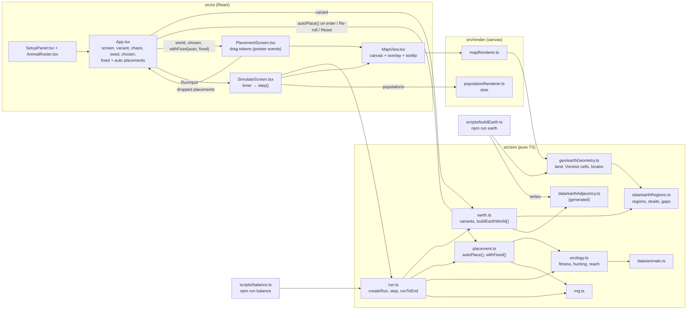

# How Thousand Years Later works

This file explains the project end to end. Keep it current: update it at the end of every build step.

_Last updated: 2026-10-20, step 2.5a (the simulation runs on the real Earth: 52 named regions, 5 Earth variants, flat placeholder drawing)._

## Player flow

| Stage | What happens | Status |
| --- | --- | --- |
| **Setup: world** | Pick an Earth variant (Today's, Ice Age, Hot, Drowned, Wild), set chaos, set or randomize the run seed. The Earth map updates live (only the variant changes it). | ✅ Built |
| **Setup: animals** | Pick 3 to 5 from the roster of 13 animals + 3 human versions (cards, amber border when selected). "Choose starting spots" → Placement. "Or start now with auto placement" → Simulate. | ✅ Built |
| **Place** (optional) | Every animal starts auto-placed (seeded). Drag tokens (mouse or touch) to place them yourself, anywhere the animal can live (land animals not at sea, sea animals not on land, shore animals by the water). While dragging: "Drop on Sahara · Good fit", or "Can't survive here · Indian Ocean" in red. Placing one animal never moves the auto ones. Sidebar: region name, biome, fit, Auto/Placed. Re-roll auto / Reset / Start 1,000 years. | ✅ Built |
| **Simulate** | 100 ticks of 10 years: plants regrow, feeding (plants, predation), growth with shared room, migration, extinction. Year counter, play/pause, 1×/4×/16×, skip to end, species ranked by biomass (bars) with head count, regions and status, raw event list with region names. | ✅ Built (no mutations, species, events yet) |
| **Run finished** | Placeholder panel at year 1000: top animal (biomass, regions), survivors, extinctions, "Run again" (back to Placement, same setup) and "New setup". | ✅ Placeholder |
| **Reveal** | "A thousand years later…": before/after maps, showcase of animated survivors, discovery cards, headlines with real places, family tree, extinctions, postcard. | ⏳ Planned (step 4) |

## Next: step 2.5b and 2.5c (designed, not built yet)

Step 2.5a moved the simulation to the real Earth (see DECISIONS.md, "Step 2.5a"). What is left of the design revision ("Design revision: real Earth, visible chaos", docs/DESIGN.md):

| Area | Today (built) | Planned |
| --- | --- | --- |
| Map drawing (2.5b) | Flat biome colors per region, thin region outlines, dark coastline (`mapRenderer.ts`), redrawn whole every frame | Storybook atlas: parchment, ink coastlines, watercolor biomes, inked symbols, hand-lettered names. Base map painted once to an offscreen canvas; creatures, territories and effects drawn on top |
| Animals on the map (2.5c) | Dots sized by count (`populationRenderer.ts`), two-letter tokens | Our own parts-based SVG creatures (`src/art/`), animated (breathing, blinking), inside parchment tokens; species territories as colored washes with dashed edges |
| Debug (2.5c) | none | Hidden Creature Lab page (all animals, anchor points marked) |

Later steps add: visible mutations and new species (step 3), animated events and Moments (step 3, which is also when `chaos` starts doing something), the reveal (step 4).

## Code flow

The tick never imports the geometry code: `run.ts` only sees `earth.ts`, which reads plain data.

### 1. The Earth as data (src/sim/data/earthRegions.ts)

- `EARTH_REGIONS`: 52 regions (39 land, 13 sea), plain data. Each has `id` ("sahara"), `name`, `center` [lon, lat] (label and token spot, also its first Voronoi site), optional extra `sites`, `isWater`, `continent` (`americas`, `eurasia`, `africa`, `australia`, `antarctica`; null at sea), `biome`, `temperature`, `elevation`, `plantFood`, all 0–1.
- Temperature uses the scale the animals' tolerances use, about (mean °C + 25) / 55: the Sahara is 0.98, Europe 0.6, Siberia 0.2, Antarctica 0. Sea colder than `WATER_ICE_LINE` (0.08) is biome `ice` (still water).
- Extra sites shape regions that one point can't: the Arctic Ocean has six along the top of the map, the North Atlantic has a North Sea, Baltic, Biscay and tropical site, Siberia reaches Chukotka and Sakhalin, the Sahara has a Moroccan and an Egyptian site. Sites were placed by checking where regions touched (see DECISIONS).
- `STRAITS`: links on every variant even though the shapes don't touch or touch on another continent. Land: Bering (Siberia–Alaska), Gibraltar (Southern Europe–Sahara), Sinai (Middle East–Sahara), and the Southeast Asia–Australia chain (Southeast Asia–Indonesia, Indonesia–New Guinea, Indonesia–Outback). Sea: Gibraltar (North Atlantic–Mediterranean), a passage narrower than the adjacency grid.
- `WATER_GAPS`: island pairs whose shapes spill across a narrow sea but never count as touching: English Channel (British Isles–Europe), Sea of Japan (Japan–East Asia), La Pérouse (Japan–Siberia).

### 2. Region shapes and adjacency (src/sim/geo/, scripts/buildEarth.ts)

- Shapes live in a flat lon/lat plane (equirectangular) that wraps at ±180°. A land region owns the land closer to one of its sites than to any other land site; a sea region owns the sea the same way. So shapes are Voronoi cells (land sites and sea sites are two separate diagrams) clipped to land or sea.
- `earthGeometry.ts` (pure, deterministic, heavy):
  - `landFeature()`: Natural Earth 1:110m land from `world-atlas/land-110m.json` via `topojson-client`. Rings that cross the antimeridian (Chukotka, Fiji, Wrangel) are unwrapped so every edge is short; tests shift by ±360°.
  - `isLand(lon, lat)` (even-odd, so the Caspian is water) and `landMask(step)` (scanline over every ring, XOR so lakes cut holes).
  - `computeContacts` / `computeTouching`: a 0.25° grid over the globe, each cell owned by the nearest site of its medium (wrapping distance). Two regions touch when at least `MIN_CONTACT` (4) cell edges separate them, so a speck of island doesn't link regions. 0.2 s.
  - `regionCells(regions)`: Voronoi polygons per region from `d3-delaunay`, with copies of every site shifted ±360° so cells wrap; bounds [−180, 180] × [−90, 90]. A region can have several polygons.
  - `createRegionLocator(regions)`: point → region: land test, then `Delaunay.find` among that medium's sites (with the wrapped copies).
- `npm run earth` (`scripts/buildEarth.ts`) checks every center is inside its own region and writes `src/sim/data/earthAdjacency.ts`: `EARTH_TOUCHING`, the touching pairs (land–land, land–sea, sea–sea; 152 pairs). Text format in `geo/adjacencyFile.ts`. A test fails if the committed file is out of date, so rerun it after editing regions or sites.

### 3. Earth variants become a world (src/sim/earth.ts)

- `EARTH_VARIANTS`: each has `temperatureShift`, `defaultChaos`, `biomeChanges` ([region id, biome] pairs, applied in order), `floodBelow` (elevation) and `landBridges`.
  - **Today's Earth:** no changes.
  - **Ice Age Earth:** −0.12 temperature; ice over Canada, Alaska, the Rockies, Scandinavia, the British Isles; Europe, Eastern Forests and the Steppe become tundra; the Southern Ocean freezes on its own. Land bridges: Sahul (New Guinea–Eastern Australia), Doggerland (British Isles–Europe), Korea (Japan–East Asia).
  - **Hot Earth:** +0.12; the Sahel, Mexico, Middle East, Steppe and Great Plains become desert; Amazonia and Congo become grassland; Greenland, the Arctic and Antarctica thaw to tundra; Siberia and Alaska become forest; the Arctic Ocean ice melts on its own.
  - **Drowned Earth:** +0.04; coastal land below elevation 0.15 floods (Gulf Coast, Amazonia, the Pampas become sea); India and Southeast Asia become swamp, the British Isles coast.
  - **Wild Earth:** volcanoes in the Andes, Japan, Indonesia, East Africa and New Zealand; chaos starts at 0.9.
- `buildEarthWorld(variant)` → `EarthWorld` (cached per variant and deep-frozen; `createEarthWorld` builds a fresh copy). Regions get the shifted temperature (clamped), the new biome (plant food follows a changed biome: `BASE_PLANT_FOOD`), and sea freezes or thaws by `WATER_ICE_LINE`. A flooded region keeps its shape but `isWater` is true, `flooded` is true, its continent is null and it has sea plant food.
- Neighbors: every touching pair, except land–land pairs on different continents and `WATER_GAPS`; plus `STRAITS` and the variant's `landBridges`. Sorted and symmetric. The neighbor graph is the same on every variant except the bridges; only `isWater` and biomes change.
- `flightHops`: land one water region away that flyers can reach, only when the two centers are within `FLIGHT_RANGE_KM` (3,000 km, great circle). Owls reach Madagascar, Japan and New Zealand, never across an ocean.
- The generic shape every map has is in `src/sim/worldMap.ts`: `Region` (`id`, `name`, `elevation`, `temperature`, `biome`, `plantFood`, `isWater`) and `World` (`regions`, `neighbors`, `flightHops`). `EarthRegion` adds `key`, `lon`, `lat`, `continent`, `flooded`.

### 4. The old hex generator (kept, unused)

`generateWorld(settings)` in `src/sim/world.ts` (with `hex.ts`, `presets.ts`, `biomes.ts`'s `classifyBiome`) still builds the 8 × 6 hex worlds of steps 1–2 and returns a `HexWorld` (a `World` plus `settings`, `cols`, `rows`, regions with `q`, `r`, `moisture`). Nothing in the game uses it; it stays tested for a future "Alien worlds" mode. Its renderer is kept as `src/render/hexMapRenderer.ts`.

### 5. Animals (src/sim/data/animals.ts)

Plain data, no logic. Each `Animal`: `id`, `name`, `short` (token label), `role`, 0–1 stats `size`, `speed`, `attack`, `defense`, `diet` (0 plants … 1 meat), `heatTolerance`, `coldTolerance`, `habitat` (`land` | `water` | `both`), `flies` (owl), `breedingRate`, `foodNeed`, `preferredBiomes` (best first), `mutationLuck` (unused until step 3; smart humans 0.3, others 0.1), `isHuman`.

### 6. Ecology (src/sim/ecology.ts)

- `regionFitness(world, animal, regionId)` = habitat × temperature × biome, 0–1.
  - Habitat: water-only 1 at sea / 0 on land; land-only the reverse; `both` (shore animals: frog, crocodile, penguin) is 1 on coast/swamp, 0.9 on other land next to water (most Earth regions; the Great Plains, Gobi and Himalaya don't touch the sea), and 0 at sea or inland.
  - Temperature: comfortable range `[0.55 − 0.6·cold, 0.45 + 0.6·heat]`, falling to 0 at 0.25 outside it.
  - Biome: 1 for the first preferred biome, −0.08 per rank, 0.5 if unlisted.
- `fitLabel`: ≥ 0.65 "Good fit", ≥ 0.35 "Okay fit", else "Bad fit".
- `huntVulnerability(pred, prey)`: 0 unless prey is smaller and the predator's hunt power (0.4 attack + 0.35 size + 0.25 speed) beats the prey's escape power (0.4 defense + 0.35 size + 0.25 speed) by more than 0.03; then min(1, 2.5 × gap). Nothing hunts its own species, and the three human versions don't hunt each other.
- `reachableRegions`: neighbors the animal can live in (habitat > 0), plus `flightHops` for flyers. Sharks only reach water and shore animals only the shore, because habitat is 0 elsewhere.

### 7. Auto placement (src/sim/placement.ts)

`autoPlace(world, chosenAnimals, fixedPlacements, seed)` keeps fixed placements, then for each other animal (in chosen order) scores every livable region by fitness, prefers regions nobody else starts on, and picks at random (`createRng(seed + "|place")`) among those within 85% of the best score. If nowhere is livable it takes a free region in the animal's own medium if there is one, else any free region.

`withFixed(chosen, auto, fixed)` gives each animal its fixed spot, else its auto spot. App computes `auto` only on entering placement (run seed), Re-roll (new random seed, avoiding fixed spots) and Reset, so dropping one animal never moves the others.

### 8. The run (src/sim/run.ts)

- `RunInput = { earthVariant, chaos, seed, chosenAnimals, placements }` (placements: animalId → regionId). Missing placements are auto-placed with the seed. The map comes from the variant alone; the seed drives auto placement and the tick's randomness. `chaos` is stored but unused until step 3 (events, mutations). This is everything needed to reproduce a run.
- `RunState`: input, world (`EarthWorld`), tick, year, `plants[]` per region, `climate` (world-wide drift) and `weather[]` (per-region drift), `populations[]` (`{animalId, regionId, count}`, sorted by region then chosen order), `species[]` (per-species totals for peak/extinction tracking). Plain data; `step` never mutates its input.
- `createRun(input)`: each animal starts in its region at 35% of its capacity. Capacity = `60 / (0.1 + size)`.
- `step(state) → { state, events }`. RNG for a tick is `createRng(seed + "|tick|" + tick)`.
  1. **Plants** move halfway toward a ceiling of `plantFood × 100 × factor`, where `factor = 1 + climate + weather[region]`, clamped to 0.2–1.6. Both drifts are AR(1): `climate = 0.85·climate + noise(±0.3)` (slow, world-wide: decades-long good and bad spells) and `weather = 0.6·weather + noise(±0.25)` per region. Plants above a falling ceiling shrink toward it (droughts).
  2. **Fitness** per population (above).
  3. **Feeding.** Need = count × foodNeed, split by diet. Plant demand is shared from up to 80% of the region's plants, in proportion to demand × competitive weight (`0.6 + 0.4·attack + 0.4·size`, so big, fierce grazers get first pick). No one gets more than it asked for; leftovers go back to the rest. Meat: each predator splits its demand over catchable prey (weighted by count × meat value × vulnerability) plus a "wild meat" source (fish, insects, small game): 8 per tick on land, ×1.15 at sea, times `factor^0.5`, so bad years hit hunters too, half as hard as plants. A prey can lose at most 80% × vulnerability of its biomass per tick. Omnivores then cover part of a meat shortfall from leftover plants. `fed` = got / need.
  4. **Growth:** `count × (1 + r·fitness·fed·room·mates − hunger − 1.5·(1 − fitness)² − lonely) − kills`, with `r = 0.15 + 0.9·breedingRate` and `hunger = 0.8·(1 − fed)·(0.5 + foodNeed)` (big eaters starve faster). Fitness 0 (wrong medium) loses 70% per tick.
     - **Shared room (Lotka–Volterra):** `room = 1 − Σ (count_j / K_j) × α_ij` over everyone in the region (α = 1 for itself). `α_ij = min(3, 1 × overlap × (strength_j / strength_i)³)`, where overlap = `1 − |diet_i − diet_j|` and strength = competitive weight × local fitness. Same-diet species crowd each other and the stronger, better-fitted one takes the region; a negative room shrinks the loser. Mates are applied only while room is positive.
     - **Allee effect:** `mates = min(1, count / (0.3 × K × (1 − 0.4·diet)))`. Below that line a population breeds slower and loses `lonely = 0.4 × (1 − mates)` per tick. Hunters' line is lower because they always live spread thin.
  5. **Migration:** a population stranded in the wrong medium (a shark dropped on land) can't leave. Otherwise the share leaving = 4% + crowding (above 60% of K) + hunger, capped at 35%, to the best two reachable regions with fitness ≥ 0.45 (weighted by fitness × free room × a little noise). A new population needs at least 1 founder. Land animals change continents only across straits and bridges, because those are the only cross-continent neighbors.
  6. **Extinction:** populations below 0.5 are removed (`regionLost`); a species with none left is `extinct`.
- Events (`RunEvent`): `{ year, type, animalId, regionId, count? }`, types `spread`, `regionLost`, `extinct`, `peak`. A peak is reported once the total falls 25% below a high that was at least 1.5× the lowest point *before* that high. It is dated to the year of the high, so it arrives after later events (the UI sorts by year).
- `runToEnd(input) → { finalState, history, events }`; `history` is a `Snapshot` (populations + plants) every 10 ticks, including year 0 (11 total).

### 9. Drawing the map (src/render/mapRenderer.ts)

- Equirectangular, latitudes 84° N to 80° S (`LAT_TOP`, `LAT_BOTTOM`). `computeLayout(width, height)` fits the 360° × 164° map, centered, and returns `scale` (px per degree), `originX/Y` and `size` (9° in pixels, which token and dot sizes scale with). `project` and `regionAt` convert between lon/lat and canvas.
- `drawMap` each frame: sea cells filled with their biome color (frozen sea `SEA_ICE_COLOR`) and outlined; then, clipped to the land outline (even-odd, so the Caspian stays water), land cells in biome colors (flooded land shows as ocean) and outlined; then the coastline. The land path comes from `d3-geo` (`geoEquirectangular` scaled to match the linear projection; it cuts the antimeridian). Cells and the locator are built once from `EARTH_REGIONS`.
- The hovered or drop-target region is tinted and outlined in its medium only (land or sea), plus its own stretch of coast, amber or red (`THEME.danger`) for a blocked drop.
- `regionAt(layout, x, y)` → nearest region of the medium under the pointer (`createRegionLocator`), or null off the map.
- `populationRenderer.ts`: one dot per species per region in a small ring around the region center, sized by count / capacity, light outline.
- `src/ui/MapView.tsx` owns the `<canvas>`: it measures its container in a layout effect (and then via ResizeObserver) and draws in a layout effect, so the map is there on the first painted frame. The backing store is `round(css size × devicePixelRatio)`, resized only when it changes; a `matchMedia` resolution listener redraws sharp after zoom or a move to another screen. The tooltip shows the region name, biome (or "Flooded"), temperature, elevation and plant food. `Legend` lists the biomes on the current map.

### 10. Screens

- `App.tsx` holds the screen and the inputs: `variantId`, `chaos`, `seed`, chosen animals, `fixed` and `auto` placements, run input. `world = buildEarthWorld(variantId)`. Picking a variant also resets chaos to its `defaultChaos`. "Random seed" (`labels.ts`, `randomSeed()`) uses `Math.random()`, fine outside the sim. Setup → `goToPlacement` (clears fixed placements, computes auto ones) or `startWithAuto` (auto-places and goes straight to Simulate).
- `SetupPanel`: variant chips with the variant's one-line blurb, the chaos slider (Calm … Wild), the run seed with a note that the map stays the same.
- `PlacementScreen` gets `placements = withFixed(chosen, auto, fixed)` from App. Tokens are HTML elements over the canvas (`MapView`'s `overlay`). Pointer events with pointer capture handle mouse and touch; `regionAt` turns the pointer into a region. A press only becomes a drag after 6 px of movement, so a tap leaves the token on Auto. Tokens are 34–64 px (0.78 × region size). Tokens sharing a region fan out. Dropping sets `fixed[animal]`, unless `habitatFit` is 0 there: then the token snaps back. While dragging, the target region gets the amber outline (`highlightId`) and a "Drop on Sahara · Good fit" label, clamped inside the map; where the animal can't live, the outline, label ("Can't survive here · Indian Ocean") and token turn red. The sidebar shows region name, biome, fit and Auto/Placed. "Re-roll auto" re-runs `autoPlace` with a new random seed (fixed animals stay put); "Reset" clears `fixed` and goes back to the run-seed auto placements.
- `SimulateScreen` builds a `RunState` with `createRun`, and a `setInterval` calls `step` at 2 ticks/s × speed (1×, 4×, 16×). "Skip to the end" steps until finished. Dots come from `drawPopulations` (`MapView`'s `drawExtra`). Species are ranked by biomass (`speciesBiomass` = population × size); bars are biomass against the highest biomass seen this run; each row shows head count and regions (`speciesRegions`). The finished panel names the top animal with its biomass and regions. Status compares a species total with 3 ticks ago (±5%). The event list is newest first, sorted by year, with region names ("Rabbit spread to The Steppe").

### 11. Balance script

`npm run balance [-- --runs 500 --seed balance]` (`scripts/balance.ts`, run with tsx): a random Earth variant (equally likely, with its default chaos), random 3–5 animals, auto placement. Then a "human league" (half as many runs) with all three human versions in every run, plus 0–2 random animals, so the versions are compared head to head. Per animal it prints: survival at year 1000, `top` (largest biomass = population × size at year 1000, the headline metric), `regions` (average regions occupied at year 1000 when it survived), `top#` (largest head count), `top@200` (largest biomass at year 200, for "dominates early") and `worst drop` (average biggest fall from a high, for "crashes"). Plus survival per Earth variant, average survival, runs with at least one extinction, the highest `top` share, wipeouts and average survivors. Seeded, so reports are reproducible. Targets: 50–80% average survival, a loser in most runs, no animal `top` in more than ~35% of its runs.

Last report (200 runs, seed "balance"): average survival 79% (variants 75–82%), extinctions in 58% of runs, lizards top in 38% of their runs over 7.4 regions (was 76% over 12.2). Still above target: rabbits (48%; 43% at 600 runs on another seed), smart humans (48% here, 33% in the human league) and rats (up to 44% on another seed). See DECISIONS.md.

## Data rules between layers

- `src/sim` → produces plain data (`World`, `Region`, `EarthWorld`). Imports nothing from render or ui.
- `src/sim/geo` → geometry for scripts, tests and the renderer. The tick (`run.ts`, `ecology.ts`, `placement.ts`, `earth.ts`) never imports it.
- `src/render` → reads that data (and the geometry) and draws it. Never changes it.
- `src/ui` → holds the inputs, calls `buildEarthWorld`, passes the result down. Never changes world objects (they are frozen).
- The simulation advances `RunState` in `src/sim` via `step()`; the simulate screen only shows the result. It runs on the main thread (a full run takes a few ms).
- `RunInput` (variant + chaos + seed + chosen animals + placements) is the whole deterministic input.

## Tests

- `src/sim/rng.test.ts`: same seed gives the same sequence, different seeds differ, values stay in [0, 1).
- `src/sim/earth.test.ts`: 40–55 regions with unique ids and valid values; the regions named in the design exist and every continent has land; straits, gaps and bridges name real regions; worlds are deterministic (deep equal) and frozen; every region has neighbors, lists sorted and symmetric; coasts, land borders and sea links that must exist, and pairs that must not touch; every sea connects to every other sea; land on different continents meets only across straits/bridges; Bering, Gibraltar, Sinai and the island chain join the right continents, and walking over land reaches every continent but not Antarctica or the islands; Ice Age opens its three bridges; variants change ice, deserts, jungle, melting, flooding (coastal land only) and volcanoes as described; a changed biome brings its own plant food; flight hops reach nearby islands only.
- `src/sim/geo/earthGeometry.test.ts`: the committed adjacency file is up to date; land/sea tests (Caspian is water, Chukotka across the antimeridian is land); the land mask agrees with `isLand`; every center is in its own region; every region has a cell inside the map; the locator wraps at ±180°.
- `src/sim/run.test.ts`: identical results for the same RunInput; the seed and variant change the history while the map depends only on the variant; placements change history; `step` doesn't mutate; a cloned state steps identically; water/land/shore animals never in the wrong medium on every variant; every new population is reachable from where its species lived the tick before; land animals leave Africa only across Sinai or Gibraltar; a shark dropped on land can't swim out; predators reduce prey; a population with its plants removed declines; spread and peak events appear; extinction logged once.
- `src/sim/placement.test.ts`: deterministic; respects fixed placements; a new seed re-rolls only auto animals; shares a region only when the player did; distinct livable regions unless every livable region is taken (every variant); picks good regions; seed changes placements; placing an animal never moves the auto ones.
- `src/sim/ecology.test.ts` (on every variant): sharks reach only water, land animals only land, shore animals never water; owls cross exactly one water region; owls reach Madagascar from East Africa and wolves don't; habitat fitness rules; who can hunt whom; all 16 animals have 0–1 stats, and smart humans have the highest mutationLuck.
- `src/sim/hex.test.ts`, `src/sim/world.test.ts`: the kept hex generator (unchanged).
- `src/sim/purity.test.ts`: scans `src/sim` (including subfolders) for `Math.random`, `Date`, DOM globals, React, and imports from render/ui.
