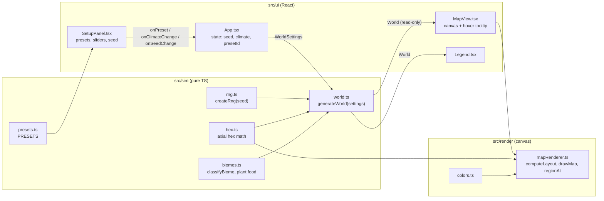

# How Thousand Years Later works

This file explains the project end to end. Keep it current: update it at the end of every build step.

_Last updated: 2026-10-18, step 1 (world generation and map). Player flow updated for the revised design (placement step, 13 animals + 3 humans)._

## Player flow

| Stage | What happens | Status |
| --- | --- | --- |
| **Setup: world** | Pick a climate preset, tweak sliders (temperature, rainfall, sea level, chaos), set or randomize a seed. The hex map updates live. | ✅ Built |
| **Setup: animals** | Pick 3 to 5 from the roster of 13 animals + 3 human versions. "Start with auto placement" skips straight to the simulation. | ⏳ Planned (step 2) |
| **Place** (optional) | Every animal starts auto-placed on a hex that suits it (seeded). Drag tokens to place them yourself, even somewhere bad on purpose. Sidebar shows each animal's region and fit. Re-roll auto / Reset. | ⏳ Planned (step 2) |
| **Simulate** | 100 ticks of 10 years: plants grow, populations grow, shrink and move, mutations, new species, discovery checks (docs/DISCOVERIES.md), events. Year counter, speed controls, chronicle. | ⏳ Planned |
| **Reveal** | "A thousand years later…": before/after maps, discovery cards, headlines, new species, family tree, extinctions, postcard. | ⏳ Planned |
| **Replay** | Back to placement with the same setup, tweak one thing, or start fresh with a new seed. | ⏳ Planned |

## Code flow (what exists today)

### 1. Settings become a world

- `WorldSettings` (`src/sim/world.ts`): `seed` (string) plus `temperature`, `rainfall`, `seaLevel`, `chaos`, all 0–1.
- Presets (`src/sim/presets.ts`) are just named sets of those four numbers. `PRESETS` is the list shown as chips.
- `generateWorld(settings)` in `src/sim/world.ts` is a pure function that returns a `World`:
  1. **Grid.** 8 columns × 6 rows = 48 pointy-top hexes. Stored in axial coordinates (`q`, `r`), laid out as a rectangle in "odd-r" offset form (odd rows shift right). Region `id = row * cols + col`. Hex math is in `src/sim/hex.ts` (`offsetToAxial`, `gridNeighbors`, `hexToPixel`, `pixelToHex`, `hexCorners`).
  2. **Random fields.** Each field gets its own RNG stream: `createRng(seed + "|elevation")`, `"|moisture"`, `"|jitter"`, `"|volcano"`. `smoothField` blurs random values across hex neighbors (2 passes) and stretches them back to 0–1, so land forms blobs instead of speckles.
  3. **Elevation.** Smoothed noise, lowered toward the map edges (so land gathers in the middle), plus chaos-driven roughness, then normalized to 0–1.
  4. **Water.** `isWater = elevation < seaLevel`. Because elevation is normalized, sea level is roughly "the share of the map that is water".
  5. **Moisture.** Water is 1. Land is rainfall + noise + a bonus for each water neighbor.
  6. **Temperature.** Global temperature, minus latitude (cooler toward the top and bottom rows), minus height above sea level.
  7. **Biome.** `classifyBiome` in `src/sim/biomes.ts` picks from temperature, moisture, height and whether the region touches water. Very cold water becomes `ice` but keeps `isWater: true`. `volcanic` only appears when chaos > 0.7 (the Volcanic preset uses 0.9).
  8. **Plant food.** `BASE_PLANT_FOOD[biome]`, nudged up by moisture on land.
- Helpers: `regionNeighbors(world, id)` and `regionIdAt(world, q, r)`.

### 2. The world gets drawn

- `src/render/mapRenderer.ts`:
  - `computeLayout(world, width, height)` fits the whole grid into the canvas and returns `{ size, originX, originY }`.
  - `drawMap(ctx, world, layout, hoveredId)` fills each hex with its biome color (`src/render/colors.ts`), leaving a small gap, and outlines the hovered hex in amber.
  - `regionAt(world, layout, x, y)` turns a mouse position back into a region id (for the tooltip).
- `src/ui/MapView.tsx` owns the `<canvas>`: it watches its container size (ResizeObserver), handles devicePixelRatio, redraws when the world, size or hover changes, and shows the tooltip (biome, temperature, moisture, elevation, plant food).

### 3. The UI triggers regeneration

- `src/ui/App.tsx` holds the only state: `seed`, `climate` (the four sliders) and `presetId`.
- `world = useMemo(() => generateWorld({ seed, ...climate }), [seed, climate])`. Any change to the seed, a slider or a preset makes a new world right away. Generation takes well under a millisecond, so there is no debounce.
- Clicking a preset sets all four sliders. Moving a slider by hand clears the active preset (the title then says "Custom").
- "Random seed" (`src/ui/labels.ts`, `randomSeed()`) uses `Math.random()`. That's fine because it is UI, not sim.

## Data rules between layers

- `src/sim` → produces plain data (`World`, `Region`). Imports nothing from render or ui.
- `src/render` → reads that data and draws it. Never changes it.
- `src/ui` → holds settings, calls `generateWorld`, passes the result down. Never changes world objects. To change the world, change the settings and generate again.
- Later, the simulation will advance world state inside `src/sim` (possibly in a Web Worker), and render/ui will only show snapshots.
- Planned run inputs: `WorldSettings` + chosen animals + placements. Placements are part of the deterministic input, so the same seed, settings and placements must give the same history. Auto placement will live in `src/sim` and use the seed.

## Tests

- `src/sim/rng.test.ts`: same seed gives the same sequence, different seeds differ, values stay in [0, 1).
- `src/sim/hex.test.ts`: offset/axial round trip, neighbors at corners and edges (both even and odd rows), neighbor symmetry, pixel ↔ hex round trip.
- `src/sim/world.test.ts`: deterministic deep-equal worlds, different seeds give different worlds, values in range, every preset has land and water across several seeds, volcanic only with high chaos, presets lean toward their theme.
- `src/sim/purity.test.ts`: scans `src/sim` for `Math.random`, `Date`, DOM globals, React, and imports from render/ui.
