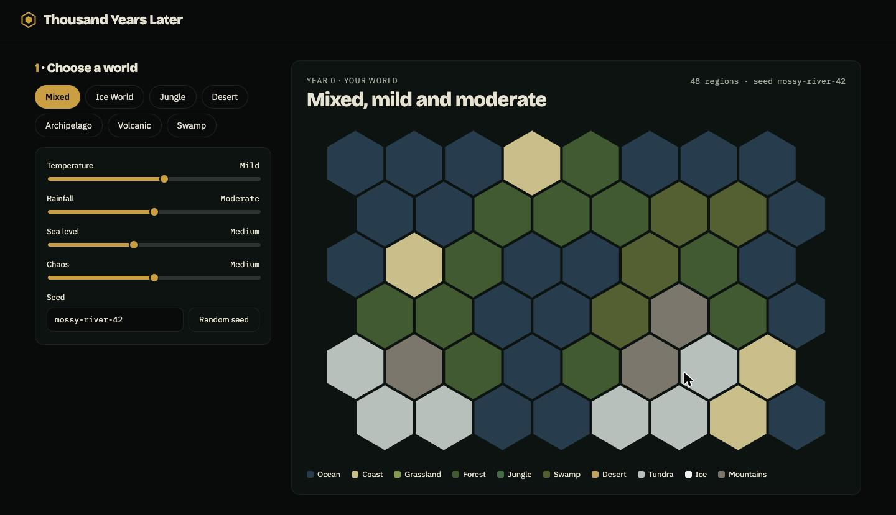

# Thousand Years Later

A browser game about cartoonish evolution. Pick a climate and a few real animals, decide where they start, fast-forward 1,000 years, and see what the world and its creatures turned into.



> **Status: early development.** The world generator and map are playable today. Animals, the simulation and the big reveal are next. See the [roadmap](#roadmap).

## The idea

1. **Set up:** choose a world (Ice World, Jungle, Desert, Archipelago, Volcanic, Swamp or Mixed) and 3 to 5 animals from a roster of 13, plus three versions of humans.
2. **Place:** every animal starts somewhere sensible, or drag them anywhere you like. Penguins in the desert is a valid experiment.
3. **Simulate:** watch centuries fly by as populations spread, mutate, split into new species, and survive (or don't) ice ages, meteors and plagues.
4. **The reveal:** *"A thousand years later…"* Find out what lives on, what died out, and what strange new creatures appeared.
5. **Replay:** try new starting spots, tweak one thing, or use a new seed for a whole new history.

Along the way you might stumble on **discoveries**: re-evolved mammoths, killer rabbits, even dragons.

Fun over realism: expect fanged snow rabbits and owls that gave up flying. The full design is in [docs/DESIGN.md](docs/DESIGN.md), and discoverable creatures are in [docs/DISCOVERIES.md](docs/DISCOVERIES.md).

## What works today

- **Seeded world generation:** 48 hex regions with elevation, moisture, temperature, biome and plant food. The same seed and settings always give the exact same world.
- **Seven climate presets** and four sliders (temperature, rainfall, sea level, chaos). The map regenerates as you drag.
- **Eleven biomes:** ocean, coast, grassland, forest, jungle, swamp, desert, tundra, ice, mountains, and volcanic (high chaos only).
- **Hover any hex** to see its biome and stats.

## Getting started

Requires Node.js 20 or newer.

```bash
npm install
npm run dev      # start the dev server
npm test         # run the test suite
npm run build    # type-check and build a static site into dist/
```

## How it's built

- **Vite + React + TypeScript** (strict mode), **Canvas 2D** for the map, **Vitest** for tests.
- A static site with no backend.

```
src/
  sim/      pure TypeScript game logic: world generation, hex math, seeded RNG
  render/   canvas drawing (reads world state, never changes it)
  ui/       React components
```

Everything in `src/sim` is deterministic and free of DOM code. All randomness comes from a seeded generator, so worlds (and later, whole histories) can be shared, replayed and batch-tested headlessly. A test enforces this.

For a deeper tour, read [FLOW.md](FLOW.md) (how data moves through the app) and [DECISIONS.md](DECISIONS.md) (what was decided and why).

## Roadmap

- [x] Hex world, biomes, climate presets, rendered map
- [ ] Animals and humans with stats, food chain, populations growing and moving, placement screen
- [ ] Mutations, new species and names, world events, discoveries, balancing script
- [ ] The reveal screen
- [ ] Creature portraits and the shareable postcard
- [ ] Bestiary, challenges, daily world
